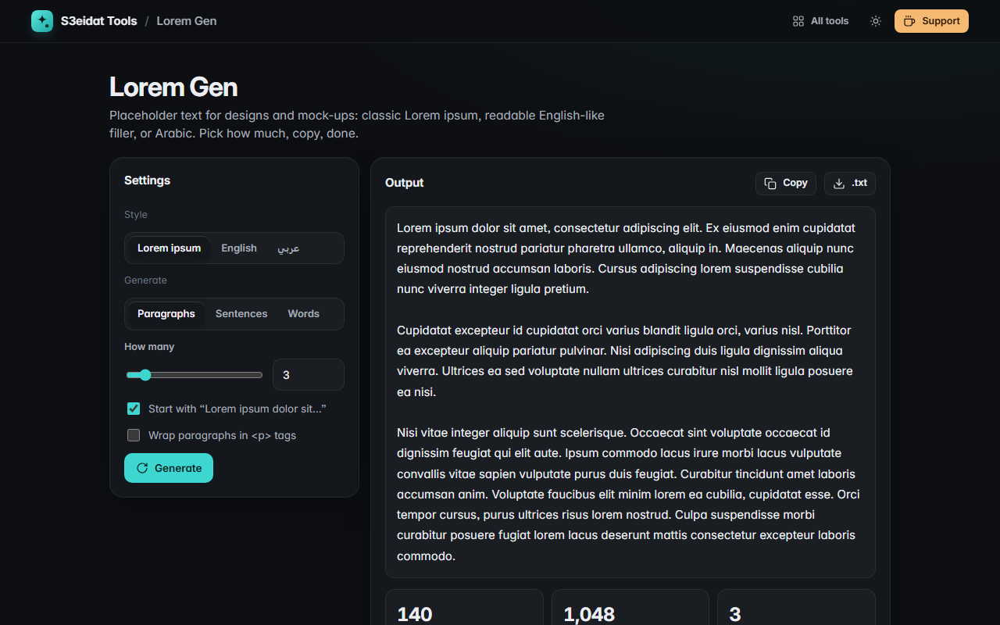

# Lorem Gen

> Placeholder text in English and Arabic. Free, private, and it runs entirely in your browser.

### ▶ [Open Lorem Gen](https://s3eidat.github.io/lorem-gen/)



## Features

- Three styles: **classic Lorem ipsum**, readable **English-like** filler, and **Arabic** placeholder text (right-to-left)
- Generate **paragraphs** (up to 100), **sentences** (up to 500) or an exact number of **words** (up to 10,000)
- Optional classic opening line (“Lorem ipsum dolor sit amet…”, “The quick brown fox…”, “هذا النص هو مثال لنص…”)
- Optional **`<p>` tags** for pasting straight into HTML
- Live word and character counts, copy, or download as `.txt` / `.html`
- Remembers your settings on this device

All words come from lists built into the page; nothing is fetched.

## Privacy

Nothing you do here leaves your device. There is no server, no account, no analytics.
The page ships with a strict Content-Security-Policy (`connect-src 'self'`), so the browser
itself blocks any attempt to send data anywhere.

## Run it yourself

It's plain HTML, CSS and JavaScript with no build step:

```bash
git clone https://github.com/s3eidat/lorem-gen
cd lorem-gen
python -m http.server 8000
```

Then open http://localhost:8000.

## Support

If this saved you time, **[buy me a coffee ☕](https://s3eidat.github.io/coffee/)**. It keeps every tool free.

---

Part of **[S3eidat Tools](https://s3eidat.github.io/)**: 100+ free, private tools that run in your browser. MIT licensed.
